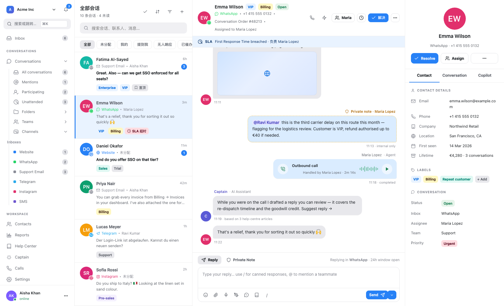

# Chatwoot 全渠道收件箱技术调研（供 ABB 借鉴）

调研对象：[chatwoot/chatwoot](https://github.com/chatwoot/chatwoot) `v4.18.0`（Rails 7.2 + Vue 3），
本地检出 `/Volumes/DataExt/GitHub/chatwoot`。

目的：Chatwoot 把"17 条消息渠道 → 一个统一收件箱"这件事做得相当干净，其**分层方式**和
**入向幂等纪律**对 ABB 的多通道（飞书 / 微信 / 钉钉）桥有直接借鉴价值，也能回答
`docs/session-isolation.md` 之外"人物维度"和"渠道能力维度"该放哪一层的问题。

本文只谈**收件箱（消息）**，VoIP 见 `research-chatwoot-voip.md`。
配套界面还原：`docs/design/chatwoot-inbox-ui.html`——**多页面交互原型**（hash 路由 + 真交互，非静态截图），
单文件零外链，浏览器直接打开；含明/暗主题、`⌘K` 命令面板，`#/selftest` 内置 44 条断言。



> 上图即本文讨论的"全渠道收件箱"产品形态：左导航 → 会话列表 → 聊天面板（含 `voice_call` 通话气泡与 Captain 建议）→ 联系人面板。
> 原型可实操：发消息 / 私密备注 / 解决 / 分配 / **批量操作** / **保存视图（Folders）+ 筛选构建器** /
> **自动化规则编辑器** / **联系人合并** / **权限矩阵**，共 18 个页面（会话 · 收件箱 · 联系人 · 报表 · 帮助中心 ·
> Captain · 通话 · 设置 · 登录 · 客户端挂件）。设置里 22 个 Tab 含 **自动化规则 / 宏 / 快捷回复 / SLA / 分配策略 /
> 角色权限 / 审计日志 / 通知设置**。页面清单与交互说明见 `docs/design/README.md`。

---

## 术语澄清（先读，避免歧义）

中文「收件箱」在 Chatwoot 里对应**三个互不相同的东西**，混用会读错本文：

| 说法 | 指什么 | 位置 | 本文用不用 |
|---|---|---|---|
| **`Inbox`（模型）** | **一条渠道连接**——渠道无关的业务实体（工作时间 / 自动分配 / CSAT / 问候语都挂它），1:1 对应一个 `Channel::*` | `app/models/inbox.rb` | **本文全部用它**（本文标题的"收件箱"= 这个实体） |
| **Inbox View（UI）** | **agent 的个人收件箱页**——侧边栏 `Inbox` 菜单，基于 **notifications**（@我 / 分配给我 / 被通知），不是账号级会话列表 | `dashboard/routes/dashboard/inbox/`（flag `inbox_view`，默认关、`chatwoot_internal`） | 不涉及 |
| **Conversation 列表** | **账号级全量会话**（另一个侧边栏入口 `Conversations`） | `dashboard/routes/dashboard/conversation/` | 不涉及 |

另需区分「**谁的收件箱**」——Chatwoot 并非只做第三方聚合，它自己就产收件箱：

| 档位 | 渠道 | 谁提供入口 | 谁提供传输 |
|---|---|---|---|
| **两端都归自己** | **Web Widget**（网站实时聊天） | Chatwoot | **Chatwoot 自己**：SDK 由 `/packs/js/sdk.js` 提供，走 `resource :widget` + Public API（`public/api/v1/inboxes/*`）+ ActionCable 直连 |
| **自带渠道入口** | **API channel**（`Channel::Api`） | 用户自己 | 用户自己的系统（Chatwoot 只收不发） |
| **自己就是邮箱** | **Email**（入向域名） | Chatwoot 可托管 `MAILER_INBOUND_EMAIL_DOMAIN`，回复地址 `reply+<conversation.uuid>@<domain>`，新建渠道自动生成 `forward_to_email` | 自托管需自建 MX；填了 IMAP/SMTP 则退回"接第三方邮箱" |
| **纯聚合** | WhatsApp / Telegram / LINE / Instagram / … | 第三方平台 | 第三方平台 |

> 读本文时，「入向」= 消息从渠道进入 `Inbox`（模型）；「出向」= agent 通过 `Inbox` 的渠道适配器发回。
> agent 个人收件箱 UI（`inbox_view`）与渠道是否自研，**都不是本文主题**。

---

## 0. 一句话结论

Chatwoot 的收件箱本质是**四层解耦**：`Inbox`（渠道无关的业务实体）→ `Channel::*`（渠道适配器）
→ `ContactInbox`（人在渠道上的身份映射）→ `Conversation/Message`（统一会话与消息）。
真正值钱的不是"支持多少渠道"，而是这三条纪律：

1. **入向入口必须极薄**（校验 → 入队 → 立刻 ack），否则被 provider 的 webhook 重放拖死；
2. **幂等在数据库唯一约束 + 分布式锁上收口**（不是"业务里判一下有没有"）；
3. **渠道差异全部下沉到 `content_type` / `content_attributes`**，主链路（路由 / 自动化 / 报表）
   对渠道零感知。

---

## 1. 数据模型：四层解耦

### 1.1 实体图

```
Account
  └─ Inbox                    ← 渠道无关的"收件箱"（工作时间/自动分配/CSAT/问候语都在这）
       ├─ Channel::<Type>     ← polymorphic: channel_type + channel_id，每渠道一张表
       ├─ ContactInbox        ← 人在该渠道上的身份映射（source_id）
       ├─ Conversation        ← 归属 contact_inbox_id（不是直接挂 contact_id）
       │    ├─ Message         ← message_type / content_type / content_attributes
       │    └─ Call            ← VoIP（见另一篇）
       └─ InboxMember / AgentBot / Webhook / EmailTemplate ...
```

关键文件：

| 关注点 | 文件 |
|---|---|
| 收件箱主实体 | `app/models/inbox.rb`（283 行，`belongs_to :channel, polymorphic: true`） |
| 渠道适配器基类 | `app/models/concerns/channelable.rb`（**只有 13 行**：`has_one :inbox, as: :channel`） |
| 渠道实现 | `app/models/channel/{api,email,facebook_page,instagram,line,sms,telegram,tiktok,twilio_sms,twitter_profile,web_widget,whatsapp}.rb` |
| 身份映射 | `app/models/contact_inbox.rb` |
| 多身份解析 | `app/services/contact_inbox_source_id_resolver.rb` |
| 统一消息写入口 | `app/builders/messages/message_builder.rb` |

### 1.2 四层各自的职责（这是重点）

| 层 | 负责 | 不负责 |
|---|---|---|
| **Inbox** | 渠道无关的业务策略：`working_hours_enabled`、`enable_auto_assignment`、`lock_to_single_conversation`、`csat_config`、`greeting_message`、`timezone`、`sender_name_type` | 任何 provider 细节 |
| **Channel::\*** | 凭证、provider client、webhook 注册、能力开关（`voice_enabled?`、`inbound_calls_enabled?`） | 会话/消息业务逻辑 |
| **ContactInbox** | 一个 Contact 在某渠道上的一个身份（`source_id` = 手机号 / PSID / email / BSUID） | 跨渠道归并策略 |
| **Conversation/Message** | 状态机（`open/resolved/pending/snoozed`）、分配、统一消息结构 | 渠道协议解析 |

**为什么 `Conversation` 挂 `contact_inbox_id` 而不是 `contact_id`**：一个人可以有两个 WhatsApp 身份
（coexistence / 合并联系人），如果挂在 `contact` 上，"用哪个号回"就无法确定。Chatwoot 在
`app/services/whatsapp/incoming_message_base_service.rb` 的 `set_conversation` 里用大段注释钉死了这条：

> 复用只锚定在"解析出这条消息的那个 ContactInbox"，绝不锚定到 Contact。一个 Contact 可能
> 在同一收件箱里持有互不相关的 WhatsApp 身份……Contact 级查询分不清它们，会用 A 的身份
> 回 B 的消息。

> **对标 ABB**：ABB 现在的会话键是 `<bot>/<chat_id>`（`~/.agent-bridge/workspaces/<bot>/<chat_id>/`），
> 这正好等价于 `ContactInbox`（渠道 + 渠道内身份），而**不是** `Contact`。这个选择是对的，
> `docs/session-isolation.md` 已经把话题/群/用户的隔离矩阵讨论清楚了。缺的是把"人"这一维
> 显式建模出来（见 §7.2）。

### 1.3 一个收件箱 = 一条渠道连接

`Inbox` 与 `Channel::*` 是 1:1（`has_one :inbox, as: :channel`）。这带来一个很实用的效果：
**"换个 WhatsApp 号" = 新建 Inbox，而不是改配置**。历史会话、报表、自动化规则天然按 Inbox 隔离。

---

## 2. 入向链路

### 2.1 入口必须极薄（最重要的一条）

所有渠道的 webhook controller 长得几乎一样，以 WhatsApp 为例
（`app/controllers/webhooks/whatsapp_controller.rb`）：

```ruby
class Webhooks::WhatsappController < ActionController::API
  include MetaTokenVerifyConcern
  before_action :verify_meta_signature!, only: :process_payload

  def process_payload
    if inactive_whatsapp_number?              # 停用号直接 422，不落库
      render json: { error: 'Inactive WhatsApp number' }, status: :unprocessable_entity
      return
    end
    return head :ok if tracking_events_only?  # 与我们无关的事件类型直接吞掉
    Webhooks::WhatsappEventsJob.perform_later(params.to_unsafe_hash)
    head :ok                                  # ← 立刻 200，绝不在请求里干重活
  end
end
```

三个动作，顺序固定：

1. **鉴权**（签名/verify_token）——不通过直接拒；
2. **过滤**（停用号 / 无关事件类型）——在入口就丢掉，别进队列；
3. **入队 + 立刻 ack**——provider 超时会疯狂重放，请求里做任何 IO 都会放大风暴。

同目录的其余入口都是这个形状：`instagram_controller`、`line_controller`、`sms_controller`、
`telegram_controller`、`tiktok_controller`、`shopify_controller`、`stripe_app_controller`。

### 2.2 入向服务内部：以 WhatsApp 为例

真正干活的是 `app/services/whatsapp/incoming_message_base_service.rb`（`perform` 入口），
它把**跨渠道共通的那几件事**都处理了：

```ruby
def process_messages
  return if unprocessable_message_type?(message_type)     # 反应/阅后即焚等直接跳过
  return if find_message_by_source_id(messages_data.first[:id])  # 幂等：已处理过
  return unless lock_message_source_id!                    # 幂等：Redis SET NX 抢锁

  set_contact
  return unless @contact
  return if @contact.blocked? && !outgoing_echo           # 屏蔽联系人

  ActiveRecord::Base.transaction do
    set_conversation
    create_messages
  end
end
```

一个渠道的入向服务通常要回答四个问题（这正是新渠道接入的"契约"）：

1. **去重键是什么？**（`source_id` = 平台消息 id）
2. **这人是谁？**（`set_contact`，含别名/身份变更）
3. **落到哪条会话？**（`set_conversation`，复用规则）
4. **消息长什么样？**（`create_messages`：文本/附件/位置/引用）

### 2.3 幂等三件套

Chatwoot 用了三层，缺一不可：

| 层 | 手段 | 位置 | 防什么 |
|---|---|---|---|
| 应用层 | `find_message_by_source_id(...)` | `incoming_message_base_service.rb` | 已存在就跳过（便宜） |
| **并发层** | **Redis `SET NX`**（`lock_message_source_id!`） | 同上，注释点名"Meta 配置错导致重复推送，多 worker 会同时处理" | 两个 worker 同时进来 |
| 存储层 | `messages.source_id` 上的唯一约束 | `db/schema` + `Message` 校验 | 兜底 |

> **对标 ABB**：ABB 的幂等键是 `mid`，落在 `msgstore.rs` 的 `UNIQUE(mid, direction)` +
> `INSERT OR IGNORE`，并且 `pending.rs` / `history.rs` / `recover` 三处共用同一 mid 语义——
> 这在**单进程**前提下已经够了，没有 Chatwoot 的多 worker 竞态，不需要 Redis 锁。
> 要警惕的是：ABB 现在"同一消息的 user 轮与 assistant 轮共用同一 mid，靠 `direction` 区分"
> 这个设计（`msgstore.rs` 注释有说明）比 Chatwoot 的"一条消息一个 source_id"更紧。将来若
> ABB 引入多进程/多实例（例如 service 与 GUI 之外再起一个），**幂等必须从"内存/单进程串行锁"
> 升级为数据库层的唯一约束 + 抢锁**——Chatwoot 这三层就是现成的模板。

### 2.4 身份解析（`ContactInboxSourceIdResolver`）

`app/services/contact_inbox_source_id_resolver.rb` 解决的是"来了一条消息（或一通电话），
它属于哪个 ContactInbox"。签名：

```ruby
ContactInboxSourceIdResolver.new(
  inbox: inbox,
  source_ids: source_ids,            # 候选身份（WhatsApp 会带 BSUID 别名）
  contact_attributes: {...},
  prefer_first_source_id: whatsapp_provider?   # 优先命中首选别名
).perform
```

它同时兜住"并发 webhook 同时创建同一个 ContactInbox"的竞态（`RecordNotUnique` 后重查）。
**VoIP 的入向复用了同一个 resolver**——这是 Chatwoot 里很漂亮的一笔：电话和聊天落到同一个人。

### 2.5 会话复用规则

`set_conversation` 的规则（来自注释，逐条抄）：

- 只在**能寻址的 identity** 上锚定会话（360Dialog 发不出某个身份，就不要在上面开会话）；
- 若 `inbox.lock_to_single_conversation`：复用最后一条；
- 否则：复用最后一条**未 resolved** 的；没有就新建。

"未 resolved 才复用"这一条很关键——它让"上一轮会话已关闭 → 新开一轮"这件事变成声明式的，
而不是靠业务代码到处判断。

---

## 3. 出向链路

### 3.1 一张路由表

`app/jobs/send_reply_job.rb`：

```ruby
CHANNEL_SERVICES = {
  'Channel::TwitterProfile' => ::Twitter::SendOnTwitterService,
  'Channel::TwilioSms'      => ::Twilio::SendOnTwilioService,
  'Channel::Line'           => ::Line::SendOnLineService,
  'Channel::Telegram'       => ::Telegram::SendOnTelegramService,
  'Channel::Whatsapp'       => ::Whatsapp::SendOnWhatsappService,
  'Channel::Sms'            => ::Sms::SendOnSmsService,
  'Channel::Instagram'      => ::Instagram::SendOnInstagramService,
  'Channel::Tiktok'         => ::Tiktok::SendOnTiktokService,
  'Channel::Email'          => ::Email::SendOnEmailService,
  'Channel::WebWidget'      => ::Messages::SendEmailNotificationService,
  'Channel::Api'            => ::Messages::SendEmailNotificationService
}.freeze

def perform(message_id)
  message = Message.find(message_id)
  channel_name = message.conversation.inbox.channel.class.to_s
  return send_on_facebook_page(message) if channel_name == 'Channel::FacebookPage'
  CHANNEL_SERVICES[channel_name]&.new(message: message)&.perform
end
```

坐席在 UI 发消息 → `Message` 落库 → `SendReplyJob` 按渠道查表 → `SendOn*Service`。
**消息先落库再发送**，发送失败可以重试/补发（`Channel::Api` 与 Web Widget 没有外发通道，
回落成邮件通知——这个语义值得注意）。

### 3.2 provider client 是渠道内的下一层

`Channel::Whatsapp#provider_service` 把"同一渠道的不同供应商"再抽象一层：

```ruby
def provider_service
  if provider == 'whatsapp_cloud'
    Whatsapp::Providers::WhatsappCloudService.new(whatsapp_channel: self)
  else
    Whatsapp::Providers::Whatsapp360DialogService.new(whatsapp_channel: self)
  end
end
```

所以是**三级**：`Inbox → Channel::Whatsapp → Provider(cloud / 360dialog)`。
对于 ABB，飞书自建应用 / 飞书长连接、微信 ilink / 微信 RPA、钉钉企业应用 / Stream，
都可以套用这个"渠道 → 传输实现"的两级思路（见 §7）。

### 3.3 失败与重试

`SendReplyJob` 的队列是 `:high`，后面接 Sidekiq 重试。渠道服务抛错不会吞消息，
`message.status` 会因 provider 回调推进到 `sent → delivered → read / failed`
（`Message` 的 `enum status`）。

> **对标 ABB**：ABB 的对应物是 `src/bridge/outbox.rs` + `src/outbox.rs`：微信主动推送被拒时
> 落 outbox，下次入站补发；其它通道失败回源报错。ABB 的 outbox 是**平台特例**（只有微信需要），
> 而 Chatwoot 是**统一先落库再外发**。差异源于 ABB 的"agent 回复"是即时产出、没有工单状态机，
> 当前做法合理；**但如果 ABB 要把"投递失败"变成一等公民（比如失败要重投/要统计），
> 就应把 outbox 从"微信特例"提升为所有通道的统一投递队列**。

---

## 4. 统一消息模型

### 4.1 三个正交维度

`app/models/message.rb`：

```ruby
enum message_type: { incoming: 0, outgoing: 1, activity: 2, template: 3 }
enum content_type: {
  text: 0, input_text: 1, input_textarea: 2, input_email: 3, input_select: 4,
  cards: 5, form: 6, article: 7, incoming_email: 8, input_csat: 9,
  integrations: 10, sticker: 11, voice_call: 12
}
enum status: { sent: 0, delivered: 1, read: 2, failed: 3 }

store :content_attributes, accessors: [
  :submitted_email, :items, :submitted_values, :email, :in_reply_to, :deleted,
  :external_created_at, :story_sender, :story_id, :external_error,
  :translations, :in_reply_to_external_id, :is_unsupported, :data
], coder: JSON
```

- `message_type` = 方向 + 是不是系统活动（`activity` 不进聊天流：`scope :chat`）；
- `content_type` = **渲染形态**（决定前端用哪个组件）；
- `content_attributes` = **渠道特定载荷**（jsonb），主链路不解析它。

### 4.2 渠道差异如何收敛

三个例子说明这个模型够用：

1. **Email**：`content_attributes.email = { subject:, cc_emails:, bcc_emails:, to_emails:, html_content:, text_content: }`，
   `MessageBuilder#process_email_content` 负责生成；还有 **Liquid 模板**渲染
   （`process_liquid_in_email_body`，且保护代码块不被处理）。
2. **WhatsApp 模板**：`content_attributes.template_params`，`content_type: template`。
3. **通话**：`content_type: 'voice_call'` + `content_attributes.data = { call_id, status, direction }`
   （`enterprise/app/services/voice/call_message_builder.rb`）——**一通电话在会话里就是一条消息气泡**。

### 4.3 唯一写入口

`app/builders/messages/message_builder.rb` 是所有消息（入向经过渠道服务、出向经过 API、
通话经过 CallMessageBuilder）的落库口。它内部做：

- `message_type: 'incoming'` 只允许出现在 `Channel::Api`（**这是安全闸**）；
- `sender`：出向用 agent/bot，入向强制用 `conversation.contact`（防止伪造发送者）；
- `private` 私密备注不走外发；
- 附件 `file_type` + 语音消息 `meta.is_voice_message`；
- 转发邮件校验（`validate_forward`：必须 email 渠道、不能 private、必须有收件人）。

> **对标 ABB**：ABB 目前的消息构造散在各平台模块里（`feishu.rs` / `wechat.rs` / `dingtalk.rs`
> 各自解析出 `Ev`），统一的只是 `Ev` 结构（`mid/chat_id/chat_type/thread_id/quoted/text/
> attachments/role/sender_id/ts`）。差一个 Chatwoot 式的**单一落库口**——现在 `msgstore.rs`
> 是事实上的落库口，但构造与落库之间还有 `bridge/mod.rs` 的中间逻辑。**建议**：
> 把"构造 `Ev` → 幂等 → 落库 → 进 pending"收成一个显式函数（类似 `MessageBuilder`），
> 单测就能钉住"入向消息的 sender/direction 不可伪造"这条不变量。

---

## 5. 渠道生命周期与凭证

### 5.1 `Reauthorizable`：把"token 过期"做成状态而不是异常

`app/models/concerns/reauthorizable.rb`：渠道/集成 token 失效时**不在调用点抛错**，
而是累计错误计数，到阈值（`AUTHORIZATION_ERROR_THRESHOLD = 2`）后：

- 置 `reauthorization_required?`（Redis 标志）；
- 发管理员邮件（`reauthorization_handlers` 按模型分派）；
- 派发 `INBOX_UPDATED` 事件让前端提示"去重新授权"；
- 成功后 `reauthorized!` 清零。

**这个模式对 ABB 直接适用**：飞书 app secret / 微信 token / 钉钉 access_token 都会失效。
ABB 现在若在调用点直接失败，用户看到的是"发消息失败了"，而 Chatwoot 的设计是
"先在 UI 上出现一个'该渠道断开，请重新授权'，用户主动修"。ABB 的授权码/凭证模型
（`src/config.rs`）可以照搬这个"计数器 + 阈值 + 显式状态"。

### 5.2 webhook 注册 / 注销随渠道生命周期

`Channel::Whatsapp` 的 after_create / before_destroy 会注册与注销 Meta 侧 webhook
（`Whatsapp::WebhookSetupService` / `WebhookTeardownService`）；`Channel::TwilioSms` 同理
（`Twilio::VoiceWebhookSetupService` / `VoiceTeardownService`）。
**渠道对象的生命周期 = provider 侧回调配置的生命周期**，不需要人工去后台改。

### 5.3 能力声明的现状（ABB 可以做得更好）

Chatwoot 用 **duck typing + `respond_to?`** 表达渠道能力：

```ruby
# enterprise/app/services/voice/ring_readiness.rb
channel.respond_to?(:voice_enabled?) && channel.voice_enabled? && channel.inbound_calls_enabled?
```

`Inbox` 里也有一堆 `web_widget?` / `email?` / `whatsapp?` 的 `channel_type ==` 判断。
这是**弱点**：能力是隐式的、靠约定，没有编译期/启动期校验。

> **对标 ABB**：ABB 的 `Messenger` trait（`src/messenger.rs:165`）其实**比 Chatwoot 更好**：
> 必选 `send_text`，其余能力（`send_thread_reply` / `get_quoted_message` / `get_chat_info` /
> `chat_brief` / `create_chat` / `typing` / `user_display_name` / 附件下载）都有**默认实现**
> 并明确写了"平台支持情况"。这就是 trait 化能力声明的正确形态。
>
> **还可以再进一步**：加一个 `fn capabilities(&self) -> ChannelCaps`（纯数据位串），
> 让调用方**在做事之前**就知道能不能做，而不是"调用 → 拿到 Err → 回落"。
> 好处：UI 能直接灰掉不支持的按钮；定时任务能提前校验；日志不会满屏"平台不支持"。

---

## 6. 事件分发（可选借鉴）

Chatwoot 用 Wisper 做了 sync + async 双 dispatcher
（`app/dispatchers/{dispatcher,base_dispatcher,sync_dispatcher,async_dispatcher}.rb`），
监听器在 `app/listeners/`：`action_cable`（实时推送）、`webhook`、`automation_rule`、
`notification`、`reporting_event`、`agent_bot`、`hook`、`csat_survey`、`participation`。

```ruby
Rails.configuration.dispatcher.dispatch(
  INBOX_UPDATED, Time.zone.now, inbox: self, changed_attributes: previous_changes
)
```

**价值**：消息/会话/收件箱的每一次变更都被广播成事件，于是"报表""自动化""webhook""实时推送"
都不用侵入主链路。`reporting_events` + rollup 就是靠这个做的。

> **对标 ABB**：ABB 的对应物是 `history.rs`（上下文摘要）+ `msgstore.rs`（持久化）+
> `deliver.rs`（跨会话投递），但**没有统一的领域事件层**。`docs/message-flow-eventsourcing.md`
> 已经评估过"完整事件溯源"并得出"收益/成本不成立，不实施"的结论——那个结论我认同
> （ABB 的后端没有可靠 resume，重跑语义不可用）。
>
> **但可以取一个更小的子集**：不必上 event sourcing，只加一个**进程内的领域事件回调点**
> （消息落库后 / 投递成功后 / 会话新建后），让 history、unread、msgstore、deliver 都挂上去，
> 替代现在散落的调用。收益是"新增一个横切能力不用改主链路"，成本远低于完整事件日志。
> 这与 `docs/message-flow-eventsourcing.md` 的"替代方向"（history 升级为事件派生）是同一个思路。

---

## 7. 与 ABB 的对照

### 7.1 结构映射表

| Chatwoot | ABB 对应物 | 差距 |
|---|---|---|
| `Inbox`（渠道无关业务实体） | 无直接对应；策略散在 `config.rs` 的 `BotConfig` | ABB 的 bot 配置**混合了渠道凭证和业务策略**（如跨会话投递开关、会话隔离开关都在 bot 上）。Chatwoot 把它们分开（`Channel::*` 管凭证，`Inbox` 管策略）。 |
| `Channel::*`（渠道适配器） | `src/{feishu,wechat,dingtalk}.rs` + `Messenger` trait | ABB 更好：trait 显式声明能力。 |
| `Channel::*` 内的 `provider` 子层 | 无 | 飞书/微信/钉钉各自只有一种传输实现，暂不需要；接第二种（如微信新版 API）时可参照。 |
| `ContactInbox`（人在渠道上的身份） | 会话键 `<bot>/<chat_id>`；`msgstore` 里 `sender_id` + `sender_name` | ABB **有渠道内身份，但没有跨渠道/跨 bot 的"人"实体**。授权者（`access.rs`）是半个人实体，但只覆盖"授权"维度。 |
| `Contact`（跨渠道归并的人） | 无 | 见 §7.2。 |
| `Conversation`（会话状态机） | `sessions.rs` + `session_state.rs`；工作区目录 | ABB 的会话没有 `open/resolved/pending/snoozed` 状态机——`/new` 就换新的。IM 场景这可能是对的（对话天然连续），但要区分"话题"与"会话"时，状态机会有用（见 `session-isolation.md`）。 |
| `Message`（统一消息模型） | `Ev`（`bridge/mod.rs`）+ `MsgRow`（`msgstore.rs`） | ABB 的 `Ev` 只覆盖**入向**；`MsgRow` 是扁平文本 + 元数据。缺一个 `content_type` 式的"渲染形态"维度（JSON 卡片 / 语音 / 通话 / 表单）。 |
| `MessageBuilder`（唯一写入口） | 无显式对应 | 建议补（§4.3）。 |
| `SendReplyJob` 路由表 | `Messenger` trait 动态分派 | ABB 用 trait object 而非查表，更干净。 |
| `outbox`（统一投递队列） | `src/outbox.rs`（仅微信） | 见 §3.3。 |
| `Reauthorizable` | 各渠道模块内零散处理 | 建议补（§5.1）。 |
| `Dispatcher` + Listeners | 无 | 见 §6。 |
| `Channel::Api`（自带渠道入口） | **无** | 见 §7.3。 |
| 事件/报表 rollup | `msgstore` 查询 | 不同定位，不必照搬。 |

### 7.2 ABB 缺的"人"这一维（重点建议）

Chatwoot 的 `Contact` + `ContactInbox` 分离回答了一个 ABB 将来一定会遇到的问题：

> 同一个人，用飞书私聊我、又在钉钉群里 @ 我、还通过授权码进来过——这是三个"人"还是一个人？

ABB 现状：

- 会话 = `<bot>/<chat_id>`，天然隔离；
- `msgstore.sender_id` 只在单个 bot 内唯一（飞书 open_id / 微信 ilid / 钉钉 userid **互不相通**）；
- 授权者（`access.rs`）是一个跨 bot 的"人"概念，但只服务授权码，不与消息会话关联。

**建议（不急着做，但值得在模型上预留）**：在 `msgstore` 或 config 里加一张
`identities(bot_key, platform_user_id) → person_id` 的映射表。
收益：
- "这个人上次在钉钉问过同样的问题"这种跨渠道上下文成为可能；
- 授权者、群成员、私聊发送者可以统一；
- 跨会话投递（`deliver.rs`）目前按目标 chat 投递，将来可以按"人"投递。

成本低（一张表 + 解析函数），风险也低（不影响现有 `<bot>/<chat_id>` 隔离）。

### 7.3 `Channel::Api` 值得 ABB 考虑

Chatwoot 有一个 `Channel::Api`：**唯一允许 `message_type: 'incoming'` 的渠道**
（`message_builder.rb` 里的显式校验）。它没有外发通道，是给"自研系统把消息推进来"用的开放入口。

ABB 的场景里对应的是：**外部程序想以"某渠道的某会话"身份往 ABB 推一条消息 / 取 agent 回复**。
ABB 已有 `agent-bridge deliver`（只出不进）。若要补"入向 API"，Chatwoot 的做法可以直接抄：
开一个受限的"api 渠道"，复用同一套 `Ev` 构造与幂等路径，权限与其它渠道隔离。

---

## 8. 可借鉴清单（按投入产出排序）

| # | 事项 | 借鉴自 | 成本 | 收益 | 建议 |
|---|---|---|---|---|---|
| 1 | **入向消息显式唯一落库口 + 不变量单测**（sender/direction 不可伪造、幂等键唯一） | `Messages::MessageBuilder` | S | 高 | 做 |
| 2 | **`Reauthorizable` 式凭证失效状态机**（计数 → 阈值 → 显式"请重新授权"状态 + 通知） | `app/models/concerns/reauthorizable.rb` | S | 高 | 做 |
| 3 | **`Messenger::capabilities()` 显式能力位**（替代"调用才知道不支持"） | 反面借鉴 Chatwoot 的 duck typing | S | 中高 | 做 |
| 4 | **统一投递队列 + 投递状态**（把 outbox 从微信特例提升为全通道，加失败重投/统计） | `SendReplyJob` + `message.status` | M | 中 | 视需求 |
| 5 | **进程内领域事件回调点**（不含 event sourcing） | `Dispatcher` + `Listeners`，收敛自 `message-flow-eventsourcing.md` | M | 中 | 做 |
| 6 | **`identities → person` 身份映射表** | `Contact` / `ContactInbox` | M | 中（长期） | 预留 |
| 7 | **消息 `content_type`（渲染形态）维度** | `Message#content_type` | M | 中 | 视 UI 需求 |
| 8 | **入向 API 渠道（bring your own channel）** | `Channel::Api` | M | 中 | 视需求 |
| 9 | provider 子层（同渠道多传输实现） | `Channel::Whatsapp#provider_service` | — | 低（暂不需要） | 暂缓 |

---

## 9. 不建议照搬（附理由）

1. **多态 `channel_type` + `channel_id`（Rails polymorphic）**：这是 ActiveRecord 的产物。
   ABB 的 `Messenger` trait object 更类型安全，别退回去做"字符串查表 + 反射"。
2. **`respond_to?` 式能力探测**：ABB 的 trait 默认实现已优于它，别学。
3. **完整事件溯源 / append-only 事件日志**：`docs/message-flow-eventsourcing.md` 已论证
   不适用（ABB 后端无可靠 resume）。Chatwoot 的 dispatcher 是**进程内事件**，不是事件溯源，别混淆。
4. **每渠道一张数据库表 + 关系型建模**：ABB 是本地单用户应用，`msgstore.sqlite` 单表足够。
   借鉴**分层思想**即可，不必照搬表结构。
5. **`lock_to_single_conversation` 的语义**：Chatwoot 是"客服工单"语境（关闭就换新单），
   ABB 是"聊天助手"语境（对话连续）。直接照搬会让 `/new` 之外的语义变怪。

---

## 10. 结论

Chatwoot 的收件箱给 ABB 的最大启发不是"多支持几个渠道"，而是三条纪律：

1. **入向入口极薄**：校验 → 过滤 → 入队 → 立刻 ack。ABB 是长连接（飞书 WS / 微信扫码 /
   钉钉 Stream），没有 webhook 重放的风暴，但**"handler 里不干重活"**同样适用——现在
   `bridge/mod.rs` 的 handle 内有 per-chat 串行锁，重活若在锁内会互相阻塞，值得复核一遍。
2. **幂等收口在存储层**：ABB 的 `UNIQUE(mid, direction)` 已经对；要守住"将来若多进程，
   必须补抢锁"这条红线。
3. **渠道差异下沉到数据，不下沉到分支**：ABB 的 `Ev` + `attachments` 已接近，
   补一个 `content_type` 级的渲染形态维度即可。

最值得做的两件小事：**入向唯一落库口 + 不变量测试**（§4.3）和
**凭证失效状态机**（§5.1）。这两件都在 S 成本、高收益那一档。

---

## 附：主要参考文件清单

```
app/models/inbox.rb
app/models/concerns/channelable.rb
app/models/concerns/reauthorizable.rb
app/models/message.rb
app/models/conversation.rb
app/models/contact_inbox.rb
app/models/channel/*.rb                     （12 个渠道）
app/services/contact_inbox_source_id_resolver.rb
app/services/whatsapp/incoming_message_base_service.rb
app/builders/messages/message_builder.rb
app/jobs/send_reply_job.rb
app/dispatchers/*.rb
app/listeners/*.rb
app/controllers/webhooks/*.rb               （8 个入口）
enterprise/app/services/voice/call_message_builder.rb   （通话即消息）
```
