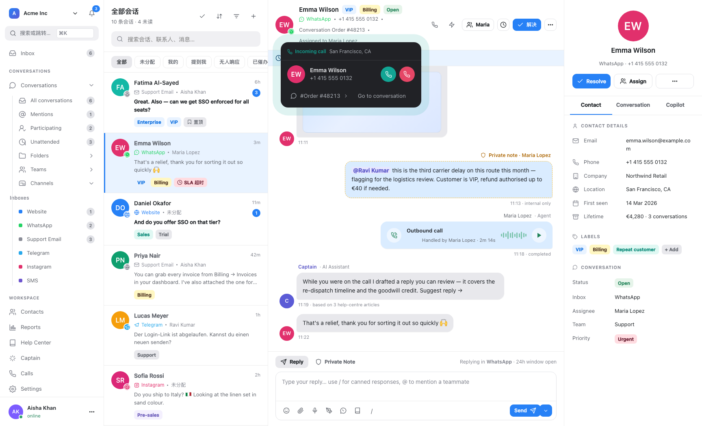
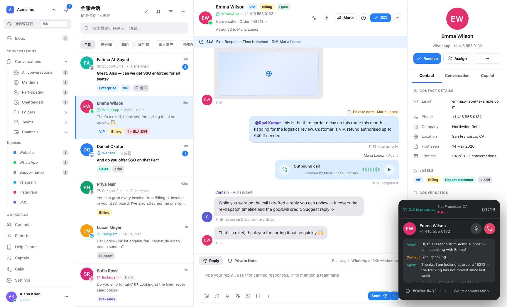

# Chatwoot VoIP（语音通话）技术调研（供 ABB 借鉴）

调研对象：[chatwoot/chatwoot](https://github.com/chatwoot/chatwoot) `v4.18.0`，代码全部位于
`enterprise/`（商业版，`channel_voice` + `mobile_voice_push` 两个 feature flag）。
本地检出 `/Volumes/DataExt/GitHub/chatwoot`。

目的：ABB 目前**没有实时语音**，只有一个"朗读"（`platform.rs` 的 `Speaker`，macOS `say`）
和平台自带的语音转文本（钉钉 `recognition` / 微信 `voice_text`）。这篇调研回答两件事：

1. Chatwoot 把"电话"接到一个消息系统上，工程上是怎么做对的（**这部分的状态机与幂等纪律
   对 ABB 现有 pending / deliver / 幂等设计有直接借鉴价值，即使 ABB 不做电话**）；
2. 如果 ABB 将来要做语音（先是语音消息 + TTS/ASR 闭环，再考虑实时通话），哪些轮子可以借、
   哪些坑已经被 Chatwoot 踩过。

消息/收件箱部分见 `research-chatwoot-omnichannel-inbox.md`。
配套界面还原：`docs/design/chatwoot-inbox-ui.html` 中的 **VoIP 弹层**——来电响铃卡、通话中悬浮窗（计时/静音/
挂断/实时转写）、通话详情（录音波形 + 说话人分离转写）。深链：`#/conversations/v1?call=ringing`、
`#/conversations/v1?call=active`、`#/calls/k1`（自测：`#/selftest`）。





---

## 0. 一句话结论

Chatwoot 的 VoIP **不是一个"通话功能"，而是一个跨外部系统的分布式状态机**，
它的真正难度全在：**回调乱序 / 重复 / 早到 / 晚到**，以及**多方（来电者、多个 agent、
浏览器、手机 App）对同一通电话的状态竞争**。

- 工程上做得**超过多数自研系统**：行锁收口、终态不可逆、精确一次广播、失败连接重判、
  双平台推送差异（iOS CallKit 不许 cancel）都考虑到了；
- 但它**不是话务平台**：没有 IVR、没有排队/技能组路由、没有实时质检、没有预测式外呼；
- 对 ABB：**"通话即消息"（一通电话在会话里就是一条 `voice_call` 消息）** 这个模型最值得学；
  其次是**外部回调的乱序处理纪律**——ABB 的 `pending.rs` / `deliver.rs` 面对的是同一个问题。

---

## 1. 总体拓扑：两套 provider，两种媒体路径

| provider | 覆盖 | 媒体路径 | 桥接 |
|---|---|---|---|
| **Twilio**（`enum provider: twilio: 0`） | PSTN 固话/手机 | 来电者 ↔ Twilio ↔ 坐席 WebRTC | **Conference**（多方会议） |
| **WhatsApp**（`enum provider: whatsapp: 1`） | Meta WhatsApp Cloud Calling | 浏览器 WebRTC ↔ Meta | 无会议，SDP 直连（`offer`/`answer`） |

两条路径的差异被压在 `Voice::Provider::Twilio::*` 与 `Whatsapp::*CallService` 里，
上层用同一个 `Call` 模型和同一个状态词表。

```
call_twiml (TwiML) ──┐
conference_status  ──┤
status             ──┼─→ Call 状态机 ─→ message(content_type: voice_call) ─→ 会话
recording_status   ──┤
whatsapp call events ┘
```

---

## 2. 数据模型：`Call`

`enterprise/app/models/call.rb`（约 150 行，含大量解释性注释）：

```ruby
STATUSES = %w[ringing in_progress completed no_answer failed rejected]
TERMINAL_STATUSES = %w[completed no_answer failed rejected]

store_accessor :meta, :conference_sid, :twilio_conference_sid, :recording_sid,
               :parent_call_sid, :initiated_at, :ended_at, :accepted_broadcast_at,
               :recording_enabled, :provider_status

enum :provider,  { twilio: 0, whatsapp: 1 }
enum :direction, { incoming: 0, outgoing: 1 }

belongs_to :account, :inbox, :conversation
belongs_to :contact, optional: true
belongs_to :message, optional: true, inverse_of: :call      # ← 通话即消息
belongs_to :accepted_by_agent, class_name: 'User', optional: true
has_one_attached :recording

before_create { self.recording_enabled = inbox.channel.try(:recording_enabled?) }
after_update_commit :cancel_phone_ring, if: :ring_just_ended?
after_commit :notify_missed_call, on: %i[create update], if: :missed_just_now?

scope :active, -> { where.not(status: TERMINAL_STATUSES) }
# 唯一约束：(provider, provider_call_id) —— 幂等的根基
# 部分索引：WHERE status = 'ringing'，给"找还在响的通话"用
```

几个**刻意**的设计：

| 设计 | 为什么 |
|---|---|
| `meta` 用 jsonb 而不是加列 | 信息形态随 provider 漂移（`conference_sid` 是 Twilio 概念，WhatsApp 没有） |
| `ring_state` 另一个 jsonb | 记录"这次响铃打给了谁 / 哪些设备 / 谁没送到"，让 cancel 只发给被打过的设备 |
| `provider_call_id` 唯一索引 | 外部回调重放时，`find_or_create` 靠它收敛 |
| `recording_enabled` 在 `before_create` 快照 | 通话中途改收件箱设置不影响已开始的通话（每一段 leg 的判定一致） |
| `missed?` 是方法而非状态 | "没人接"在不同 provider 下表现不同（`no_answer`，或 `completed/failed` 且无 agent） |

---

## 3. 呼入全流程（Twilio）

```
[1] PSTN → Twilio 号码
        │
        ├─ Twilio 请求 TwiML：POST /twilio/voice/call/:phone
        │   Twilio::VoiceController#call_twiml
        │     ├─ reject_inbound?           ← inbound 关闭 → <Reject/>
        │     ├─ resolve_call
        │     │    ├─ 来电腿（非 client:）→ Voice::InboundCallBuilder
        │     │    │     ├─ ContactInboxSourceIdResolver（与消息链路同一个解析器）
        │     │    │     ├─ 复用/新建 Conversation
        │     │    │     ├─ Call.create!(status: ringing)
        │     │    │     ├─ Voice::CallMessageBuilder → 会话里出现通话气泡
        │     │    │     ├─ record_ring_audience → ring_state['ring_recipient_ids']
        │     │    │     └─ Voice::VoipPushJob('ring')（给离线手机推）
        │     │    └─ 坐席腿（client:）→ 找已有 Call，记录"leg 在路上"
        │     └─ <Dial><Conference>conf_account_X_call_Y</Conference>
        │           来电者被放进会议等坐席
        │
[2] 坐席响铃（两路并行）
        ├─ 浏览器在线：ActionCable voice_call 事件 → FloatingCallWidget
        └─ 手机离线：iOS APNs VoIP Push(PushKit→CallKit) / Android FCM data message
        │
[3] 坐席接听
        前端 VoiceAPI.getToken(inboxId) → Twilio Voice SDK JWT
          identity = "agent-{user_id}-account-{account_id}"
          VoiceGrant: incoming_allow=true, outgoing_application_sid=twiml_app_sid
        → Device.connect() → 加入同一 Conference
          participant_label = "agent-{user_id}-account-{account_id}"
        │
[4] Conference 事件回调 → Voice::Conference::Manager（状态机，见 §4）
        start / join / leave / end
        │
[5] 状态与录音回调
        status            → Voice::StatusUpdateService     （见 §4.3）
        recording_status  → Voice::RecordingStatusService  → 挂 recording 附件
        → Voice::CallTranscriptionJob → Llm::SpeechToTextService
        → call.transcript → message.reload.send_update_event（重广播）
```

**关键点**：`call_twiml` 是**幂等可重入**的——Twilio 重试时它只是重新渲染 TwiML，
不会重复建 Call（已有 Call 会被 `find_existing_call` 命中，并**补发一次 ring**，
见 `InboundCallBuilder.queue_ring` 的注释）。

---

## 4. 状态机（这是全文最值得读的部分）

### 4.1 三层状态，各有各的职责

| 层 | 类 | 职责 |
|---|---|---|
| 归一化 | `Voice::StatusUpdateService` | 把 provider 原始回调映射成内部状态；**丢弃乱序/过期** |
| 迁移 | `Voice::CallStatus::Manager` | 在**行锁内**决定状态怎么变（含迟到的"已接听"） |
| 编排 | `Voice::Conference::Manager` | 多方竞争（谁先接 / 谁挂断 / 失败重判 / 自动分配） |

### 4.2 `Voice::CallStatus::Manager`：终态不可逆 + 迟到答案

```ruby
def process_status_update(status, duration: nil, timestamp: nil)
  return unless Call::STATUSES.include?(status)
  call.with_lock do                     # ← 锁在最新行上，不是调用方的副本
    if late_answer?(status)
      record_late_answer!(timestamp)    # agent 腿没加进会议 → 判了 no_answer
                                        # 但联系人其实接了 → 补偿成 failed + 记 started_at
    else
      next if keep_current_status?(status)
      apply_call_updates!(status, duration: timestamp, ...)
    end
    call.conversation.update!(last_activity_at: Time.zone.now)
    call.message&.touch                 # 触发 message.updated 重广播（带新 Call 载荷）
  end
end

def keep_current_status?(status)
  call.status == status ||
    Call::TERMINAL_STATUSES.include?(call.status) ||      # 终态不可被迟到回调覆盖
    (status == 'ringing' && call.in_progress?)            # 接了就不会再响
end
```

`started_at` 取**最早**（Twilio 会重复发 `in-progress`），`duration_seconds` 在缺 duration 时
用 `ended_at - started_at` 兜底。

### 4.3 `Voice::StatusUpdateService`：乱序回调用"序"来解，不用时间戳

Twilio 的回调**可能乱序到达**（网络/队列），Chatwoot 的方法是给 provider 状态定义

```ruby
PROVIDER_STATUS_ORDER      = %w[queued initiated ringing in-progress]
ACTIVE_PROVIDER_STATUSES   = %w[in-progress inprogress answered]
TERMINAL_PROVIDER_STATUSES = %w[completed busy no-answer failed canceled]

def stale_provider_status?(current, incoming)
  incoming_rank < current_rank        # 终态 rank 最高 → 永远不会被打回
end
```

并且**把 provider 原始状态单独存进 `meta['provider_status']`**——因为 Twilio 的
`queued/initiated/ringing` 在 Chatwoot 里都映射成 `ringing`，但前端要显示
"对方正在响铃"这一**时刻**。注释写得很清楚：

> Twilio 自己的状态与 call 的状态并排放。queued/initiated/ringing 在这里都映射成 ringing，
> 但只有最后一个意味着对方手机真的在响，前端要展示那个时刻。

写 `provider_status` 用的是 `with_lock { call.merge_meta!('provider_status' => ...) }`——
**只 merge 这一个 key**，避免两个并发回调互相覆盖 meta。

### 4.4 `Voice::Conference::Manager`：多方竞争的编排

299 行，事件四种：`start` / `join` / `leave` / `end`。逐条列出它处理的竞态：

| 竞态 | 处理 |
|---|---|
| **多个 agent 同时接** | `claim_for_user!`：`with_lock` 内 first-join-wins，后到的静默忽略（**用户可见的拒绝在 API 层做**，webhook 层不打扰） |
| **"已接听"广播重复发** | 独立的 `accepted_broadcast_at` 闸门（不能用 `call.status` 当判据——它可能已被别处回调改成 `in_progress`） |
| **来电者在响铃期间挂断** | `leave_finds_live_call?` 在同一行锁内判：要么来电者挂断落在 join 之前（判 missed），要么落在之后（判 answered） |
| **agent 连接换新（重连）** | 旧 leg leave 时若新 leg 还在路上 → **等待**而不是判挂断；超时后 `FailedAddRecheckJob` 重判 |
| **agent leg 加不进会议** | `failed_add?`（`leave_reason == 'participant_add_failed'`）走独立分支：释放 claim → 让其它 agent 继续响；或结束通话 |
| **联系人的状态回调先到** | `contact_leaving_answered_call?`：即使 call 已终态，会议里还在的 agent 也要被挂断 |
| **Twilio 暂时查不到会议参与者** | `other_agents_remain?` rescue 后**返回 true**（保守：假设还有人），并排 `EndConferenceJob` 重试——**不允许"未知"导致提前结束通话** |
| **结束会议失败** | 所有 direct 调用都 rescue → `Voice::EndConferenceJob`（`queue_as :critical`，`LATE_ROUNDS = 3`，`LATE_ROUND_WAIT = 5.minutes`）兜底 |
| **挂断联系人失败** | `HangUpContactJob` 重试，避免联系人在会议里干等到 Twilio 超时 |
| **会议 SID 伪造 / 串号** | `extract_user_id` 校验 label 里的 account_id 与 call 一致，防跨账户冒用 |

`pickup / 自动分配`：agent 抢到的那一刻，若会话还没 assignee，就
`Conversations::AssignmentService` 把会话分配给他（并记录 `assigned_by_claim`，
失败连接释放时能精确撤回）。

---

## 5. 呼出

`enterprise/app/services/voice/outbound_call_builder.rb`（83 行），有一个很值得抄的细节：

```ruby
ActiveRecord::Base.transaction do
  contact_inbox = ensure_contact_inbox!
  conversation  = @existing_conversation || create_conversation!(contact_inbox)
  # Dial before locking so the Twilio round-trip doesn't hold the conversation row lock.
  call_sid = initiate_call!               # ← 外部 API 先做完
  if claim_for_caller
    @existing_conversation.lock!
    @existing_conversation.update!(assignee: user)
  end
  call    = create_call!(conversation, call_sid)
  message = Voice::CallMessageBuilder.new(call).perform!
  call.update!(message_id: message.id)
  # 行提交前到达的状态回调找不到 Call；提交后主动补齐一次
  ActiveRecord.after_all_transactions_commit { Voice::SyncProviderStatusJob.perform_later(call.id) }
end
```

**"先做外部调用再做锁"**：外部 HTTP 往返（Twilio REST）可能几百 ms 到秒级，把它放进行锁内
会把整个会话的其它写操作堵住。这条规则对 ABB 的 `deliver` / agent 调用同样适用。

**`SyncProviderStatusJob`** 处理"回调早于行可见"：通话先拨、行后提交，
Twilio 的回调可能在这中间到达 → 找不到 Call → 丢弃；提交后主动 `fetch` 一次 provider 状态补上。
这是**外部系统与本地事务的经典时序洞**，ABB 的 `pending.rs` W1/W2 是同一类问题。

---

## 6. 响铃与推送（`Voice::VoipPushService`，316 行）

三个角色分工：

- **`RingRecipients`**：决定"打给谁"——有 assignee 且还能分配就只打他，否则打给**所有
  能打开该会话且 `availability: online`** 的坐席。**故意不看 socket 在线**：
  > 锁屏手机的 socket 离线的，正是 ring push 存在的理由。

- **`RingReadiness`**：诊断"为什么没响"——返回 `voice_off` / `ringing_off` / `no_inboxes` /
  `not_online` / `no_device` / `push_unavailable` 之一。这是**可解释的失败**，直接给 Super Admin
  诊断页用。

- **`VoipPushService`**：实际推送。关键差异：

| 平台 | 机制 | ring | cancel |
|---|---|---|---|
| **iOS** | APNs VoIP push（PushKit → CallKit） | 有 | **故意不发**——CallKit 要求每个 VoIP push 都报告一个通话，给已结束的响铃发 cancel 会弹"幽灵来电"。iOS 靠 App 被唤醒后连 socket、从 `voice_call` 事件得知结果 |
| **Android** | FCM 高优先级 data message | 有 | **有**——Android 的响铃只有通知栏 + App 自己的界面，必须显式撤 |

其它要点：

- `RING_LEASE_SECONDS = 30`：防止重复 ring job 叠加；租约内别的 job 等待重试；
- `RING_EXPIRY_SECONDS = 45`：响铃上限；
- `ring_state` 记录 `ring_recipient_ids` / `rung_user_ids` / `unreached_user_ids`，
  **cancel 只发给被打过的设备**，且会话中途改派不会打错人；
- 两个平台**并行推送**（各自线程）：Google 取 token 慢不拖累 APNs；
- 推送前每次批量检查 `keep_ringing?`（绕过 query cache 读，避免回答缓存的旧状态）。
- `MissedCallNotificationJob`：漏接通知**只发给当时被打过的坐席**（读 `ring_state` 快照），
  之后的改派不影响"谁漏接了"。

---

## 7. 录音与转写

```
recording_status 回调 → Voice::RecordingStatusService → provider 取录音 → Call#recording (ActiveStorage)
                                                                    │
                                        Voice::CallTranscriptionJob (queue: low)
                                                                    │
                                                    Voice::CallTranscriptionService
                                                      ├─ 已有 transcript 就不重复转（避免重复扣费）
                                                      ├─ recording 必须 attached
                                                      ├─ inbox.channel.transcription_enabled?
                                                      ├─ Llm::SpeechToTextService.available_for?(account)
                                                      └─ timestamp: 0.0（降低静音幻觉）
                                                    → call.transcript
                                                    → message.reindex（高级搜索）
                                                    → message.reload.send_update_event（重广播）
```

`Llm::SpeechToTextService`（`enterprise/`）同时服务**语音消息附件**与**通话录音**，
有一个很实用的细节：

```ruby
# OpenAI 的转写端点硬上限是 25 MB **十进制**（25_000_000），不是二进制
# （25.megabytes = 26_214_400）——用二进制形式会把 25.0–26.2 MB 区间送给 API 拿 413。
BYTE_LIMIT = 25_000_000
```

`SpeechToTextService.available_for?` 要求 `captain_integration` 且有余量，转写按次扣额度
（`account.increment_response_usage`）。

> **对标 ABB**：ABB **不自己做 ASR**，而是消费平台自带的转写：
> - 钉钉 `content.recognition` → `AttachmentDesc::Dingtalk.voice_text`（`dingtalk.rs:892`）
> - 微信 `WechatMedia.text` → `voice_text`（`wechat.rs:315`），落到 `meta.note`
> - 飞书没有自带转写（`voice_text: String::new()`）
>
> 这个策略在**成本**上是对的（不付 ASR 钱、不传音频出本机）。Chatwoot 的教训是：
> **转写要幂等（已有就不重跑）、要限额、要显式不可用（而非静默失败）、要区分"附件已到"
> 与"转写未完成"两个时刻都广播**（`Enterprise::Concerns::Attachment` 里
> `enqueue_audio_transcription` + `broadcast_message_update_for_audio` 两个 after_create_commit）。

---

## 8. provider 适配层

```
Voice::Provider::Twilio::
  Adapter                    # 发起呼叫（REST calls.create）
  ConferenceService          # 会议生命周期（end / 列参与者 / 挂断联系腿）
  TokenService               # 生成 WebRTC JWT（identity + VoiceGrant，ttl 1h）
  RecordingAttachmentService # 取回录音并挂附件
```

`Channel::Whatsapp` 甚至专门注释了"刻意和 `Channel::TwilioSms#voice_enabled?` 形状对齐，
方便调用方 duck-type"：

```ruby
# Mirrors Channel::TwilioSms#voice_enabled? so the call subsystem can duck-type across providers.
def voice_enabled?
  voice_calling_supported? && provider_config['calling_enabled'].present? &&
    account.feature_enabled?('channel_voice')
end
```

`TokenService` 的 JWT（`Voice::Provider::Twilio::TokenService`）：

```ruby
identity = "agent-#{user.id}-account-#{account.id}"     # 与 participant_label 同构
access_token = Twilio::JWT::AccessToken.new(account_sid, api_key_sid, api_key_secret,
                                            identity: identity, ttl: 1.hour)
grant.incoming_allow = true
grant.outgoing_application_sid = channel.twiml_app_sid
grant.outgoing_application_params = { account_id:, agent_id:, identity:, is_agent: 'true' }
```

前端 `twilioVoiceClient.js` 用 `@twilio/voice-sdk` 的 `Device`，`tokenWillExpire` 自动续期。

**注意**：`identity` 里带 `account_id`，而 webhook 回来时 `extract_user_id` 会校验 label 里的
account 与 call 一致——**凭证里的身份与回调里的身份双向对齐**，这是防串号的关键。

---

## 9. 前端

| 文件 | 作用 |
|---|---|
| `api/channel/voice/twilioVoiceClient.js` | 封装 `Device`：初始化、token 续期、mute、disconnect、`call:disconnected` 事件 |
| `api/channel/voice/voiceAPIClient.js` | token / calls REST |
| `components-next/call/CallCard.vue` | 会话里的通话气泡（242 行） |
| `components-next/call/FloatingCallWidget.vue` | 悬浮通话窗（273 行） |
| `routes/dashboard/calls/pages/CallsIndex.vue` | 通话记录页 |
| `stores/calls.js` / `stores/callHistory.js` | 实时 / 历史 |
| `helper/voice.js` | 时长格式化等 |

前端拿到的是 `Message#content_attributes.data`（`call_source` / `call_direction` / `status`），
**不需要额外请求 `Call`**——这是"通话即消息"模型带来的好处。

---

## 10. 与 ABB 的对照

ABB 没有通话，但这两个东西和 Chatwoot 的 VoIP 面对**同一类问题**：

| 问题 | Chatwoot VoIP | ABB 对应物 |
|---|---|---|
| 外部回调重复 | `provider_call_id` 唯一索引 + `find_or_create` | `UNIQUE(mid, direction)` + `INSERT OR IGNORE`（`msgstore.rs`） |
| 外部回调乱序 | `provider_status_rank`（终态最高） | **无**——ABB 目前不处理"迟到/乱序的确认" |
| 回调早于本地行可见 | `SyncProviderStatusJob`（提交后主动 fetch 补齐） | `pending.rs` W1/W2 崩溃窗口（`docs/message-flow-eventsourcing.md` 已讨论） |
| 同一事件只能广播一次 | `accepted_broadcast_at` 精确一次闸门 | DONE 回执 / `mark_started` 身份校验 |
| 多方竞争同一资源 | `with_lock` + first-join-wins + claim | `task_store` 的"认领是单锁 check-and-set" |
| 受众快照（防止中途改派） | `ring_state['ring_recipient_ids']` | `deliver` 多目标投递的接收人快照（建议补） |
| 外部 API 失败 | 全部 rescue → 重试 job（`EndConferenceJob`/`HangUpContactJob`） | outbox 补发 + `recover.rs`（`RESUME_MAX_ATTEMPTS = 2` 冻结） |
| provider 能力差异 | duck typing `voice_enabled?` | `Messenger` trait 默认实现（ABB 更好，见另一篇 §5.3） |
| 凭证过期 | `Reauthorizable` | 渠道模块内零散处理 |
| 推送平台差异 | iOS `ring-not-cancel` / Android `ring+cancel` | **无推送**（ABB 是主动拉/常驻连接） |

### ABB 可以直接学的三条（与做不做电话无关）

1. **给"外部事件确认"定序，而不是靠时间戳**。ABB 现在收到平台事件就处理，
   没有"终态不可逆"的概念。若将来有"消息已撤回 / 已编辑 / 已送达"这类**可迟到**的平台回调，
   `provider_status_rank` 的写法可以直接搬：给状态排序，终态最高，迟到的早期状态直接丢。

2. **精确一次的外部副作用用独立闸门**。`accepted_broadcast_at` 的注释点明了一个反直觉的事：
   **不要用主状态字段判断"是否已广播过"**，因为它会被别的路径改。
   ABB 的 DONE 回执 / 去重若用类似字段判断，要复核是否会被并发路径污染。

3. **失败连接要能"重判"而不是"终局"**。`failed_add` + `FailedAddRecheckJob` 的模式：
   遇到"看起来失败但可能是 timing 问题"时，不立即下终态，而是**排一个延迟任务重判**。
   ABB 的 `RESUME_MAX_ATTEMPTS = 2` 冻结机制是"重试 N 次后放弃"，Chatwoot 是"等一个明确的
   时间窗后再判"——两种都行，但 ABB 缺"等待中对端可能自己好了"的那条路径。

---

## 11. 可借鉴清单（若 ABB 要做语音）

按"投入产出 + 风险"排序：

| 阶段 | 事项 | 借鉴自 | 成本 | 说明 |
|---|---|---|---|---|
| P0 | **语音消息 + 平台转写归一**：把钉钉/微信的 `voice_text`、飞书的空 `voice_text` 统一成"语音消息 + 可选转写文本"，并保证"音频已到"与"转写未完成"两个时刻都通知渲染 | `Enterprise::Concerns::Attachment` 双 after_create_commit | S | 现在 `meta.note = voice_text` 是隐式约定，建议显式化 |
| P0 | **TTS 朗读闭环**：把 `Speaker`（macOS `say`）扩展到 Windows/Linux，或接本地 TTS（ABB 侧已有 audio-cpp 等能力） | — | S–M | 现有 `Speaker::spawn_with` 已为测试注入留了口子，直接扩展 |
| P1 | **本地 ASR 兜底**：飞书语音无自带转写；可接本地模型，避免上传音频 | `Llm::SpeechToTextService`（幂等/限额/显式不可用三纪律） | M | 抄它的三纪律，不抄它的 OpenAI 依赖 |
| P1 | **音频转写任务状态机**：`pending → transcribing → done/failed`，前端据此区分"音频可播但没文字"与"转写失败" | `Voice::CallTranscriptionJob` 的 `discard_on` / `retry_on` 分类 | S | Chatwoot 明确区分"可重试"（FileNotFound）与"永久失败"（400/401） |
| P2 | **实时通话**（若要）：先做"浏览器 ↔ 坐席"（WebRTC），不要一上来做 PSTN | `twilioVoiceClient.js` + `TokenService` | L | 需要 STUN/TURN（Chatwoot 用 `stun:stun.l.google.com:19302`，可自建） |
| P3 | **PSTN / 会议桥**（若要）：接国内 CPaaS 而非 Twilio | `Conference::Manager` 的状态机 | XL | 国内合规、线路、号码落地都是独立工程 |
| — | **IVR / 排队 / 技能组路由 / 实时质检 / 预测式外呼** | **Chatwoot 没有** | XL | 这是话务平台，不是桥 |

---

## 12. 不建议照搬（附理由）

1. **Conference（会议桥）模型**：Twilio 特定。若 ABB 做实时语音，1:1 直接 WebRTC 就够，
   引入"会议"会让状态机复杂度翻 3 倍（`Conference::Manager` 299 行里大半是在处理会议特有的
   leg 竞争）。**除非**确实要"多人同时监听/接管"。
2. **`meta` / `ring_state` 双 jsonb**：Rails 无 schema 的妥协。Rust 侧应显式结构体 + 版本化
   （`serde`），别把"什么都能塞进去"的习惯带过来。
3. **duck typing 能力探测**（`respond_to?(:voice_enabled?)`）：ABB 的 trait 更好，别学。
4. **用 `call.message.touch` 触发重广播**：把"刷新缓存/推送"挂在 `updated_at` 变化上是
   Rails/ActiveRecord 的惯用法，副作用隐晦。Rust 侧应显式调事件。
5. **转写走外部 LLM**：ABB 的立身之本之一是"数据不出本机"（README 明写）。语音转写必须
   本地，不能照搬 `SpeechToTextService` 的 OpenAI 路径。
6. **`RING_LEASE_SECONDS` / 分布式租约**：ABB 单进程单机，用不上；别为了"对齐"引入租约。

---

## 13. 结论

Chatwoot 的 VoIP 值得学的**不是**"怎么接电话"，而是它处理**外部系统回调**的一整套纪律，
这套纪律与 ABB 已有的 `pending` / `deliver` / 幂等设计是同一命题：

1. **唯一键 + 抢锁**，不靠业务判断（`(provider, provider_call_id)` vs `UNIQUE(mid, direction)`）；
2. **给状态定序，终态不可逆**，迟到的早期状态直接丢（ABB 目前缺）；
3. **精确一次的外部副作用用独立闸门**，不要复用会被并发路径改的主状态字段；
4. **外部 API 先做完再拿锁**，别把网络往返放进临界区；
5. **"未知"要保守**（查不到参与者就当还有人），并排延迟任务重判，别提前下终局；
6. **通话即消息**——把"通话"表达成会话流里的一条消息，前端/历史/搜索/通知全部自动复用。

若 ABB 真要做语音，**近期的正确落点不是通话，而是把现有的语音消息闭环做扎实**：
统一"语音消息 + 转写文本"的表示、把 TTS 朗读扩到三平台、给转写加本地兜底。
这些都和 ABB "数据不出本机"的定位一致，且不需要 WebRTC/线路/合规的一整套工程。

---

## 附：主要参考文件清单

```
enterprise/app/models/call.rb
enterprise/app/models/concerns/call_recording_settings.rb
enterprise/lib/voice/call_errors.rb

enterprise/app/controllers/twilio/voice_controller.rb
enterprise/app/controllers/api/v1/accounts/calls_controller.rb
enterprise/app/controllers/api/v1/accounts/whatsapp_calls_controller.rb

enterprise/app/services/voice/inbound_call_builder.rb
enterprise/app/services/voice/outbound_call_builder.rb
enterprise/app/services/voice/conference/manager.rb
enterprise/app/services/voice/call_status/manager.rb
enterprise/app/services/voice/status_update_service.rb
enterprise/app/services/voice/recording_status_service.rb
enterprise/app/services/voice/call_transcription_service.rb
enterprise/app/services/voice/ring_recipients.rb
enterprise/app/services/voice/ring_readiness.rb
enterprise/app/services/voice/call_message_builder.rb
enterprise/app/services/voice/voip_push_service.rb
enterprise/app/services/voice/voip_push_payloads.rb
enterprise/app/services/voice/apns_voip_sender.rb
enterprise/app/services/voice/fcm_voip_sender.rb
enterprise/app/services/voice/provider/twilio/{adapter,conference_service,token_service,recording_attachment_service}.rb
enterprise/app/services/whatsapp/{call_service,incoming_call_service,call_conversation_builder}.rb
enterprise/app/services/llm/speech_to_text_service.rb
enterprise/app/models/enterprise/concerns/attachment.rb

enterprise/app/jobs/voice/{voip_push,missed_call_notification,end_conference,hang_up_contact,failed_add_recheck,sync_provider_status,call_transcription,ringing_timeout}_job.rb

app/javascript/dashboard/api/channel/voice/twilioVoiceClient.js
app/javascript/dashboard/components-next/call/{CallCard,FloatingCallWidget}.vue
```
